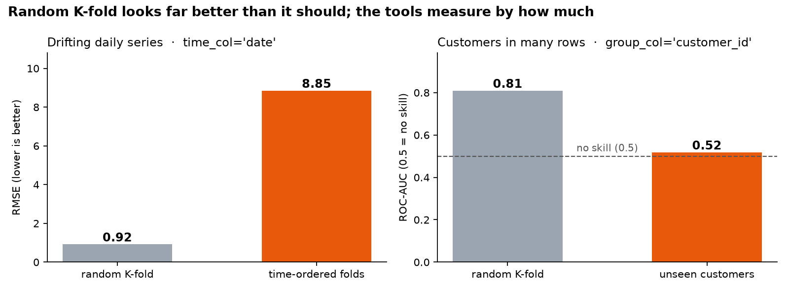

# tabular-ds-mcp

[](https://github.com/YusufErem/tabular-ds-mcp/actions/workflows/tests.yml)


[](https://colab.research.google.com/github/YusufErem/tabular-ds-mcp/blob/main/examples/kaggle_s6e11_walkthrough.ipynb)

**Honest first-hour checks for tabular ML, as tools your AI coding agent can call.**

An MCP server for Claude Code, Cursor and Claude Desktop, and a plain Python library. It inspects a competition
folder, profiles the data, compares train and test, gives a cross-validated baseline with the competition's metric
next to a no-skill baseline, and tells you when random K-fold would overstate your score.


<sub>Real output of `python -m tabular_ds_mcp.demo` on synthetic data, rendered by
[`docs/make_media.py`](docs/make_media.py).</sub>

## Try it in one minute

```bash
pip install git+https://github.com/YusufErem/tabular-ds-mcp.git      # Python ≥ 3.10
python -m tabular_ds_mcp.demo
```

The demo writes synthetic data to `./tabular_ds_mcp_demo`, runs every tool in order and prints the report above
(about 20 seconds). No account, API key or download is needed. To try it in the browser instead, open the
[Colab notebook](https://colab.research.google.com/github/YusufErem/tabular-ds-mcp/blob/main/examples/kaggle_s6e11_walkthrough.ipynb).

## Why



Random K-fold assumes every row is independent. When the test rows come later in time, or belong to customers the
model has never seen, it quietly overstates the score. With `time_col` or `group_col`, `cv_baseline` validates the
way the test set was built, runs the same model on random splits of the same rows, and reports the gap. Both panels
come from the demo; on independent rows the two agree and no warning is raised.

Three rules are built in: every score is returned next to a no-skill baseline, nothing is fitted on rows it is
scored on, and the validation scheme follows the data.

## Use it from an AI agent

```bash
git clone https://github.com/YusufErem/tabular-ds-mcp.git && cd tabular-ds-mcp
python3 -m venv .venv && .venv/bin/pip install -e .
```

**Claude Code**

```bash
claude mcp add tabular-ds -- "$(pwd)/.venv/bin/tabular-ds-mcp"
cp -r skills/tabular-playbook ~/.claude/skills/              # optional: the agent workflow below
```

**Cursor** (`.cursor/mcp.json`) or **Claude Desktop** (`claude_desktop_config.json`)

```json
{ "mcpServers": { "tabular-ds": { "command": "/absolute/path/to/tabular-ds-mcp/.venv/bin/tabular-ds-mcp" } } }
```

Then ask, for example: *“Inspect data/, run the checks it suggests and give me a baseline with the competition
metric.”*

`skills/tabular-playbook/SKILL.md` tells the agent the order of the checks (inspect → profile → compare → baseline
→ explain → submission), what the thresholds mean (adversarial AUC 0.55 / 0.65, PSI 0.1 / 0.25), when to switch to
time or group folds, and how to report: every number next to its baseline, every warning reported, no number that
did not come from a tool.

## Tools

| Tool | What it returns |
|---|---|
| `inspect_competition` | **Start here.** Finds train / test / sample submission in a folder, the target and ID columns, the task, the submission format and a likely metric, whether test rows lie later in time or belong to unseen groups, extra tables that need a join, image or text content, and the exact calls to make next |
| `profile_dataset` | Shape, column types, missing values, cardinality, duplicate rows, target balance, and warnings: constant or ID-like columns, high missing rates, possible leakage, date columns, repeated keys, free text, file paths |
| `compare_train_test` | Column and dtype mismatches, unseen categories, PSI and KS per feature, an adversarial-validation AUC with a verdict, where the test rows sit in time, and how many test rows belong to keys never seen in train |
| `cv_baseline` | Gradient-boosting scores with the competition metric, fold spread and the no-skill baseline on the same folds. Random, time-ordered or group folds; with time or group folds it also reports how much random validation would overstate the score |
| `explain_model` | Permutation importance on a hold-out split (random, latest 20% in time, or unseen groups), plus features that add nothing |
| `fit_predict` | Fits on all rows and writes the submission in the sample's format: probability, value, label, top-k labels or one probability column per class |
| `check_submission` | Columns, row count, duplicated / missing IDs, missing values, constant predictions, [0, 1] range, per-row probability sums, labels per row for top-k submissions |

All tools read CSV or Parquet, detect binary / multiclass / regression targets, and sample large files for speed.

### What it adapts to

| Situation | How it is detected | What changes |
|---|---|---|
| Test rows come later in time | date or time-index columns whose test range lies after the training range | `time_col`: folds train on the past and score the next time block; the hold-out for importance is the latest 20%; adversarial validation is also reported without the time column |
| Repeated keys (customer, store, card) with new keys in test | key-like column names, repeated values, share of test rows with an unseen key | `group_col`: no key sits in both parts of a fold, and the key is left out of the features |
| Competition metric | given by you (`metric=`), hinted by the sample submission | roc_auc, pr_auc, log_loss, accuracy, f1, mcc, macro_f1, roc_auc_ovr, qwk, map@k, rmse, rmsle (trains on log1p), mae, mape, r2 |
| Submission format | the sample submission | probability, value, label, space-separated top-k labels, one column per class |
| Extra tables, text, images | other tables sharing a column with train; long free-text columns; file-path columns and media files | reported as limitations, with the join key and rows per key |

## Use it from Python

```python
import tabular_ds_mcp as t

plan = t.inspect_competition("data/")                    # finds target, ID, task, metric hint, time/group structure
for call in plan["suggested_calls"]:                     # the calls it suggests already carry the right arguments
    result = getattr(t, call["tool"])(**call["args"])
    print(call["tool"], result.get("warnings"))
```

The [Kaggle walkthrough notebook](examples/kaggle_s6e11_walkthrough.ipynb) runs every step on Playground Series
S6E11 (credit-card fraud) and falls back to the synthetic demo data anywhere else.

## Design

- **Leakage-safe by construction.** Encoders live inside a scikit-learn pipeline that is refitted on every training
  fold; dates are split into numeric parts and categorical columns cast to strings row by row before that.
- **Baselines everywhere.** `cv_baseline` scores a no-skill model on the same folds, so a number never stands alone.
- **Validation that matches the test set.** Time-ordered and group folds, compared fold by fold with random splits of
  the same rows (for time folds, with the same training size), so the tool can say when a random K-fold score
  cannot be trusted.
- **Plain-Python core, thin MCP layer.** `core.py` holds all logic; `server.py` only exposes it, which keeps the tools
  testable and usable outside MCP.
- **Light dependencies.** pandas, NumPy, SciPy, scikit-learn (HistGradientBoosting) and the MCP SDK.

## Tests

```bash
.venv/bin/pip install -e ".[dev]" && .venv/bin/pytest
```

38 tests check every tool on small synthetic tables whose right answer is known: no shift vs. a planted shift,
signal vs. pure noise, a random-walk target where random folds must look too good and independent rows where they
must not, memorised customers, each competition metric and submission format, each kind of broken submission,
folders whose suggested calls must run as written, the one-command demo, plus an end-to-end test that starts the
server over stdio and calls it as an MCP client. They run on every push for Python 3.10, 3.12 and 3.13.

## Privacy and safety

- Everything runs locally; the tools make no network calls.
- When an AI agent calls the tools, their output goes to that agent's model, including column summaries and the
  five most frequent values of each column. Do not point the tools at data you may not share with your model provider.
- The tools write only `.csv` files (`out_path`, `oof_path`), never through a symlink.

## Limitations

- The baseline is an untuned gradient-boosting model: a reference point, not a leaderboard model.
- Forecasting problems get time-ordered validation and date parts, but no lag or rolling features.
- Extra tables are detected (with the join key), not joined; free text and images are not modelled.
- Permutation importance spreads credit across correlated features.

## License

MIT © 2026 Yusuf Ömer Erem
